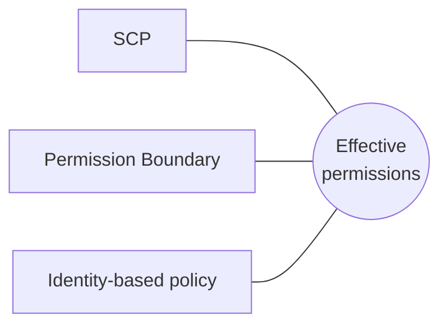
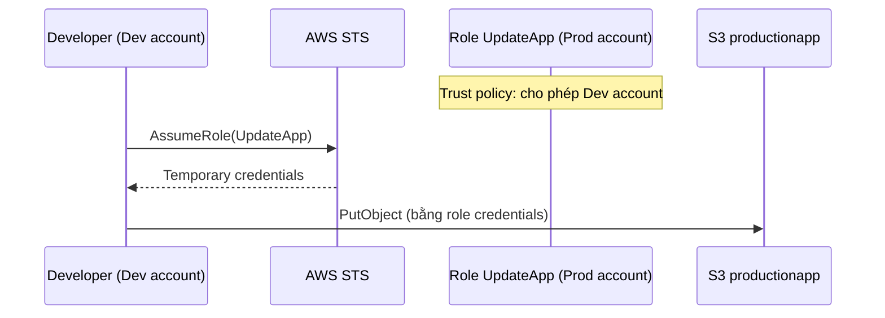
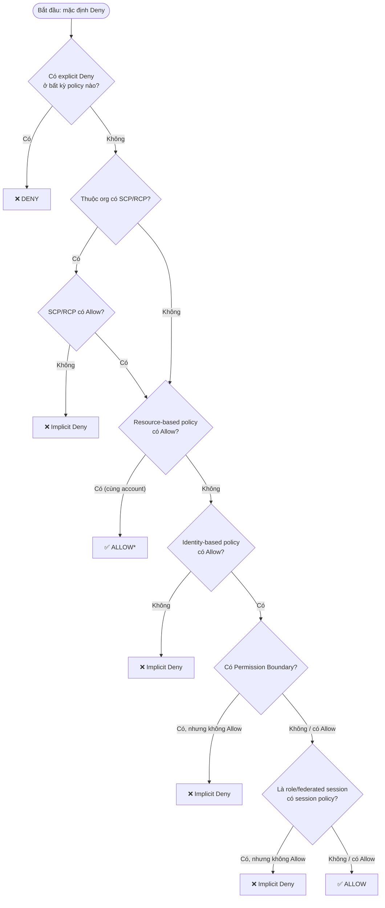

# 01 · Identity & Federation

> **Nguồn:** Slide Stephane Maarek SAP (v38, trang 9–79) + section *Identity & Federation* của khóa Udemy, có bổ sung các cập nhật mới của AWS. Ghi chú này tự viết lại để ôn tập, không chép nguyên slide.
> **Domain SAP-C03 liên quan:** Security, compliance & governance · Cloud-native architecture (multi-account)

## Mục lục

1. [IAM nền tảng – những gì đã biết từ SAA](#1-iam-nền-tảng)
2. [IAM Policy deep dive](#2-iam-policy-deep-dive)
3. [IAM Role vs Resource-based Policy](#3-iam-role-vs-resource-based-policy)
4. [Permission Boundaries](#4-permission-boundaries)
5. [IAM Access Analyzer](#5-iam-access-analyzer)
6. [AWS STS](#6-aws-sts)
7. [Identity Federation](#7-identity-federation)
8. [AWS Directory Services](#8-aws-directory-services)
9. [AWS Organizations](#9-aws-organizations)
10. [Service Control Policies & Policy Evaluation Logic](#10-service-control-policies-scp)
11. [Các loại policy khác của Organizations](#11-các-loại-policy-khác-của-organizations)
12. [IAM Identity Center](#12-iam-identity-center)
13. [AWS Control Tower](#13-aws-control-tower)
14. [AWS Resource Access Manager (RAM)](#14-aws-resource-access-manager-ram)
15. [Cheat-sheet: Tình huống → Giải pháp](#15-cheat-sheet-tình-huống--giải-pháp)
16. [Bẫy hay gặp trong đề](#16-bẫy-hay-gặp-trong-đề)

---

## 1. IAM nền tảng

| Thành phần | Đặc điểm cần nhớ |
|---|---|
| **User** | Credential **dài hạn** (password, access key) → hạn chế dùng, ưu tiên federation |
| **Group** | Chỉ chứa user, **không lồng group**, không phải principal (không đặt trong policy được) |
| **Role** | Credential **ngắn hạn** qua STS |
| **EC2 Instance Role** | Lấy credential qua instance metadata (IMDS). **Mỗi instance chỉ gắn 1 role** (qua instance profile) |
| **Service Role** | Role cho service dùng thay bạn (CodeDeploy, API Gateway…) |
| **Cross-account Role** | Role cho principal ở account khác assume |

**Các loại policy:**
- **AWS Managed** – AWS tạo & cập nhật (vd: `AdministratorAccess`, `PowerUserAccess`, `ReadOnlyAccess`)
- **Customer Managed** – bạn tạo, tái sử dụng được, có versioning
- **Inline** – nhúng trực tiếp vào 1 user/role/group, quan hệ 1-1, xóa entity là mất
- **Resource-based** – gắn vào resource (S3 bucket policy, SQS queue policy, KMS key policy…), **có trường `Principal`**

---

## 2. IAM Policy deep dive

### Cấu trúc
`Version` · `Statement[]` → `Sid`, `Effect` (Allow/Deny), `Principal` (chỉ resource-based / trust policy), `Action` / `NotAction`, `Resource` / `NotResource`, `Condition`.

### Nguyên tắc quan trọng
- **Explicit Deny > Allow > Implicit Deny (mặc định)**
- Least privilege
- **Access Advisor**: xem quyền đã cấp và **lần cuối được dùng** → dọn quyền thừa
- **Access Analyzer**: tìm resource chia sẻ ra ngoài (xem mục 5)

### `NotAction` – ví dụ `PowerUserAccess`
`PowerUserAccess` = Allow **mọi thứ trừ** `iam:*`, `organizations:*`, `account:*` (dùng `NotAction` + `Allow`), rồi thêm một statement Allow lại vài action IAM cần thiết (`iam:CreateServiceLinkedRole`, `iam:ListRoles`…).

> 💡 **`NotAction` + `Allow` ≠ `Deny`**. `NotAction` chỉ là "không cấp", nếu policy khác Allow `iam:*` thì user vẫn có quyền. Còn `Deny` thì chặn tuyệt đối.

### Condition
Cú pháp: `"Condition": { "<operator>": { "<key>": "<value>" } }`

| Nhóm operator | Ví dụ |
|---|---|
| String | `StringEquals`, `StringNotEquals`, `StringLike` (hỗ trợ `*`, `?`) |
| Numeric | `NumericLessThan`… |
| Date | `DateGreaterThan`… (vd giới hạn theo `aws:CurrentTime`) |
| Bool | `aws:SecureTransport` (bắt buộc HTTPS), `aws:MultiFactorAuthPresent` (bắt buộc MFA) |
| IP | `IpAddress` / `NotIpAddress` với `aws:SourceIp` |
| ARN | `ArnEquals`, `ArnLike` (vd `aws:SourceArn`) |
| Null | `"Null": {"aws:RequestTag/Project": "true"}` → **key không tồn tại** |
| Multi-value | `ForAllValues:` / `ForAnyValue:` (xem mục Tag) |

Ví dụ bắt buộc MFA khi xóa:

```json
{
  "Effect": "Deny",
  "Action": ["ec2:TerminateInstances", "s3:DeleteObject"],
  "Resource": "*",
  "Condition": { "BoolIfExists": { "aws:MultiFactorAuthPresent": "false" } }
}
```

### Policy Variables & Tags
- `${aws:username}` → vd mỗi user chỉ truy cập `arn:aws:s3:::mybucket/${aws:username}/*`
- **Global keys:** `aws:CurrentTime`, `aws:TokenIssueTime`, `aws:PrincipalType`, `aws:SecureTransport`, `aws:SourceIp`, `aws:userid`, `aws:RequestedRegion`, `aws:PrincipalOrgID`, `aws:SourceVpce`, `aws:SourceVpc`
- **Service-specific:** `s3:prefix`, `s3:x-amz-acl`, `sns:Endpoint`, `ec2:SourceInstanceARN`…
- **Tag-based (ABAC):**
  - `aws:PrincipalTag/<key>` – tag của người gọi
  - `aws:ResourceTag/<key>` – tag của resource bị tác động
  - `aws:RequestTag/<key>` – tag được truyền trong request (lúc tạo resource)
  - `aws:TagKeys` – danh sách key tag trong request

### Giới hạn tag bằng `aws:TagKeys`
- `ForAllValues:StringEquals` → **mọi** tag key trong request phải nằm trong danh sách cho phép
- `ForAnyValue:StringEquals` → **ít nhất một** tag key phải nằm trong danh sách

> ⚠️ `ForAllValues` trả về **true nếu request không có tag nào** → muốn bắt buộc phải có tag thì kết hợp thêm `Null` condition.

---

## 3. IAM Role vs Resource-based Policy

| | Assume Role (role làm proxy) | Resource-based policy |
|---|---|---|
| Quyền gốc | **Bỏ quyền gốc**, chỉ có quyền của role | **Giữ nguyên** quyền gốc |
| Cross-account | Principal gọi `sts:AssumeRole` | Principal gọi trực tiếp resource |
| Dùng khi | Service không hỗ trợ resource policy, cần tách biệt quyền | Cần thao tác ở **2 account cùng lúc** |

**Ví dụ kinh điển:** User ở Account A cần **đọc DynamoDB ở A** rồi **ghi vào S3 ở B** → dùng **S3 bucket policy ở B** cho phép user A. Nếu assume role sang B thì user mất quyền đọc DynamoDB ở A.

**Service hỗ trợ resource-based policy:** S3, SNS, SQS, Lambda, ECR, AWS Backup vault, EFS, S3 Glacier vault, Secrets Manager, ACM PCA, **KMS (key policy – bắt buộc)**, CloudWatch Logs destinations, API Gateway, EventBridge event bus, OpenSearch…

> 💡 **EventBridge target:** Lambda/SNS/SQS/S3 dùng **resource-based policy**; Kinesis Data Streams, ECS task, Step Functions… dùng **IAM role**.

---

## 4. Permission Boundaries

- Áp dụng cho **user và role** (**không** áp dụng cho group)
- Dùng **managed policy** để đặt **quyền tối đa** mà entity có thể có
- **Quyền thực tế = Identity policy ∩ Permission boundary** (∩ SCP nếu có)



Ví dụ: boundary cho phép `s3:*`, `cloudwatch:*`, `ec2:Describe*`; identity policy cho `iam:CreateUser` → **không có quyền gì** (giao nhau rỗng).

**Use case:**
- **Ủy quyền cho non-admin** (vd lead dev) tạo IAM user/role mới, nhưng **bắt buộc gắn boundary** cho entity mới (dùng condition `iam:PermissionsBoundary`)
- Cho developer tự gán policy cho mình mà **không leo thang quyền** (privilege escalation) thành admin
- Giới hạn **một user cụ thể** (SCP thì áp dụng cả account)

---

## 5. IAM Access Analyzer

| Tính năng | Mô tả |
|---|---|
| **External access findings** | Tìm resource chia sẻ ra **ngoài Zone of Trust** (= account hoặc organization). Resource: S3, IAM roles, KMS keys, Lambda functions/layers, SQS, Secrets Manager, SNS, EBS/RDS snapshots, ECR, EFS, DynamoDB streams/tables… |
| **Unused access findings** | Tìm role, access key, password, permission **không dùng** |
| **Internal access findings** | Ai *bên trong* org truy cập được resource quan trọng *(mới, 2025)* |
| **Policy validation** | Kiểm tra policy theo grammar & best practices → error, security warning, warning, suggestion |
| **Policy generation** | Sinh policy least-privilege từ **CloudTrail logs (tối đa 90 ngày)** |
| **Custom policy checks** | Kiểm tra policy mới có cấp thêm quyền so với baseline không (dùng trong CI/CD) |

> 🎯 Đề hỏi "*tạo policy least privilege dựa trên hoạt động thực tế*" → **Access Analyzer policy generation**.

---

## 6. AWS STS

### AssumeRole
- Định nghĩa role, **trust policy** = ai được assume
- STS trả về **temporary credentials** (AccessKeyId, SecretAccessKey, SessionToken)
- Thời hạn **15 phút → 12 giờ** (mặc định 1h; role chaining tối đa 1h)
- **Thu hồi session đang hoạt động:** gắn inline policy `AWSRevokeOlderSessions` (Deny mọi thứ với `aws:TokenIssueTime` < thời điểm thu hồi)

### Khi nào dùng AssumeRole
- User account A truy cập account B (cả hai bạn sở hữu)
- Bên thứ 3 truy cập account bạn
- AWS service truy cập resource
- User xác thực bên ngoài (federation)

### Cross-account trong cùng tổ chức
Lợi ích: phải **cấp quyền rõ ràng** để assume, user phải **chủ động switch role**, có thể **yêu cầu MFA** khi assume (`aws:MultiFactorAuthPresent` trong trust policy), audit qua **CloudTrail**.



### Bên thứ 3 & **Confused Deputy**
- Cần: **Account ID** của bên thứ 3 + **External ID**
- **External ID**: chuỗi bí mật, **do bên thứ 3 tạo ra**, duy nhất cho mỗi khách hàng; khai báo trong trust policy (`sts:ExternalId`) và **phải truyền khi assume**
- **Confused deputy:** bên thứ 3 (deputy) phục vụ nhiều khách hàng. Nếu không có External ID, khách hàng X có thể đưa ARN role *của bạn* cho deputy → deputy vô tình truy cập account bạn thay X. External ID đảm bảo deputy chỉ assume role của bạn khi đang hành động cho bạn.

```json
{
  "Effect": "Allow",
  "Principal": { "AWS": "arn:aws:iam::111122223333:root" },
  "Action": "sts:AssumeRole",
  "Condition": { "StringEquals": { "sts:ExternalId": "unique-id-from-3rd-party" } }
}
```

> 💡 Với **AWS service** làm deputy (vd SNS, CloudTrail ghi vào S3), chống confused deputy bằng **`aws:SourceArn`** / **`aws:SourceAccount`** trong resource policy.

### Session Tags
- Truyền tag khi `AssumeRole` hoặc federation → trở thành `aws:PrincipalTag`
- Dùng cho **ABAC**: vd session tag `Department=HR` → chỉ truy cập bucket `hr-docs`
- Cần quyền `sts:TagSession` trong trust policy

### Các API quan trọng

| API | Dùng khi |
|---|---|
| `AssumeRole` | Role trong account hoặc cross-account |
| `AssumeRoleWithSAML` | User đăng nhập qua **SAML 2.0** IdP |
| `AssumeRoleWithWebIdentity` | User đăng nhập qua **OIDC** IdP (Google, Facebook, Amazon, **EKS IRSA**, **GitHub Actions OIDC**…). Với app mobile/web, AWS khuyên dùng **Cognito** |
| `GetSessionToken` | Lấy credential tạm **có MFA** cho IAM user hoặc root |
| `GetFederationToken` | Credential tạm cho **federated user** qua proxy/custom broker |

---

## 7. Identity Federation

**Ý tưởng:** user quản lý **ngoài AWS** (AD, Okta, Google…), không cần tạo IAM user. IdP xác thực → AWS tin IdP (trust relationship) → cấp credential tạm.

**Các "flavor":**

| Loại | Khi nào | API |
|---|---|---|
| **SAML 2.0** | IdP doanh nghiệp tương thích SAML (ADFS, Okta, Entra ID…) | `AssumeRoleWithSAML` |
| **Custom Identity Broker** | IdP **KHÔNG** tương thích SAML | `AssumeRole` / `GetFederationToken` |
| **Web Identity (không Cognito)** | App dùng OIDC IdP – **không khuyến nghị** | `AssumeRoleWithWebIdentity` |
| **Web Identity + Cognito** | App web/mobile – **khuyến nghị** | Cognito Identity Pools → STS |
| **IAM Identity Center** | Workforce SSO cho nhiều account + SaaS app – **cách mới, ưu tiên** | (managed) |

### SAML 2.0
- Trust **2 chiều**: tạo **SAML identity provider** trong IAM (upload metadata của IdP) + cấu hình AWS là relying party trên IdP
- Truy cập **Console, CLI, API** bằng credential tạm
- Là "cách cũ"; **IAM Identity Center là cách mới, đơn giản hơn**

**Luồng API/CLI:** App → IdP (xác thực qua LDAP/AD) → nhận **SAML assertion** → gọi `AssumeRoleWithSAML` → STS trả credential → gọi AWS API.

**Luồng Console:** User → portal IdP → nhận SAML assertion → **POST tới `https://signin.aws.amazon.com/saml`** → AWS sign-in lấy credential từ STS → redirect vào Console.

### Custom Identity Broker
- Chỉ dùng khi IdP **không** hỗ trợ SAML 2.0
- Broker tự xác thực user, **tự quyết định role/quyền phù hợp**, gọi STS, trả về token hoặc **sign-in URL** cho Console
- Phải tự code & bảo trì → nhiều công vận hành

### Web Identity Federation
- **Không Cognito:** client login IdP (Google/Facebook/OIDC) → web identity token → `AssumeRoleWithWebIdentity` → credential tạm
- **Có Cognito (khuyến nghị):** client login IdP → token → **Cognito Identity Pool** đổi thành Cognito token → STS credential tạm
  - Ưu điểm: hỗ trợ **guest/anonymous**, MFA, ánh xạ role theo rule/claim, thay thế **Token Vending Machine (TVM)** tự viết
- Định danh user trong policy bằng biến: `${cognito-identity.amazonaws.com:sub}`, `${www.amazon.com:user_id}`, `${graph.facebook.com:id}`, `${accounts.google.com:sub}`

```json
{
  "Effect": "Allow",
  "Action": ["s3:GetObject", "s3:PutObject"],
  "Resource": "arn:aws:s3:::app-bucket/${cognito-identity.amazonaws.com:sub}/*"
}
```

> 💡 Phân biệt Cognito: **User Pool** = xác thực (sign-up/sign-in, trả JWT); **Identity Pool** = đổi danh tính lấy **AWS credentials**.

---

## 8. AWS Directory Services

### Nền tảng
- **Microsoft AD**: CSDL object (user, computer, printer, file share, security group) trên Windows Server có AD DS. Object tổ chức thành **tree**, nhiều tree = **forest**. Server chạy AD = **Domain Controller**.
- **ADFS**: cung cấp **SSO qua SAML** cho app bên thứ 3 (AWS Console, Office 365, Dropbox…).

### So sánh 3 lựa chọn

| | **AWS Managed Microsoft AD** | **AD Connector** | **Simple AD** |
|---|---|---|---|
| Bản chất | AD thật do AWS quản lý trong VPC | **Proxy/gateway** chuyển request về AD on-prem | Directory tương thích AD (Samba 4) |
| User quản lý ở | AWS (có thể trust on-prem) | **On-prem** | AWS |
| Trust với on-prem | ✅ one-way / two-way forest trust | ❌ (chỉ proxy) | ❌ |
| MFA | ✅ | ✅ | ❌ |
| Cache | Có (là AD thật) | **Không cache** → phụ thuộc kết nối | – |
| Seamless domain join EC2 | ✅ (cả multi-account, multi-VPC) | ✅ (EC2 join domain on-prem qua connector) | ✅ |
| RDS SQL Server, FSx Windows, WorkSpaces, QuickSight | ✅ | Hạn chế (không RDS SQL Server, không share directory) | ❌ |
| Quy mô / giá | Cao nhất | Trung bình (Small/Large) | Rẻ nhất · Small ~500, Large ~5.000 user |
| Kết nối on-prem | Cần VPN/DX khi trust | **Bắt buộc VPN/DX** | Không |

**Đặc điểm Managed Microsoft AD:**
- Multi-AZ (tối thiểu 2 DC ở 2 AZ), tăng số DC để scale
- Backup tự động, **multi-Region replication**
- Domain join seamless EC2 từ **nhiều account & VPC** (chia sẻ directory)
- Tích hợp: RDS for SQL Server, WorkSpaces, QuickSight, Amazon Connect, FSx for Windows, **IAM Identity Center**

**Trust với on-prem AD** (cần **VPN hoặc Direct Connect**):
- One-way: AWS → on-prem
- One-way: on-prem → AWS
- **Two-way forest trust**
- ⚠️ **Trust ≠ đồng bộ (replication)**: user không được copy sang

**Kiến trúc giảm độ trễ / tăng sẵn sàng:** dựng **replica AD on-prem trên EC2** (self-managed, cùng domain on-prem) → replication với on-prem; thiết lập **trust** giữa Managed AD và replica EC2. Khi VPN/DX đứt, xác thực vẫn chạy trong cloud.

> 🎯 Từ khóa:
> - "Quản lý user **hoàn toàn on-prem**, không muốn đồng bộ/lưu trên AWS" → **AD Connector**
> - "Cần **trust**, RDS SQL Server, FSx Windows, nhiều tính năng AD" → **Managed Microsoft AD**
> - "Rẻ, ít user, không cần MFA/trust" → **Simple AD**

---

## 9. AWS Organizations

- **Management account** (payer) + **member accounts**, gom thành cây **OU** từ **Root**
- Mỗi account chỉ thuộc **1 organization** tại một thời điểm

### OrganizationAccountAccessRole
- Role **full admin** trong member account, cho phép management account assume để quản trị
- **Tự tạo** khi tạo account mới qua Organizations
- **Phải tạo thủ công** nếu **mời (invite)** account có sẵn

### Chiến lược multi-account
- Tách account theo: phòng ban, cost center, dev/test/prod, yêu cầu tuân thủ (SCP), **cô lập resource**, **service quota riêng**, account riêng cho **logging** và **security**
- Multi-account vs single account multi-VPC: multi-account cô lập mạnh hơn (blast radius, quota, billing)
- Tag chuẩn hóa cho billing
- **CloudTrail organization trail** → gửi log về S3 ở **Log Archive account**
- CloudWatch Logs tập trung về logging account

**Ví dụ cấu trúc OU:** theo Business Unit (Sales/Retail/Finance), theo môi trường (Prod/Dev/Test), theo dự án. Khuyến nghị hiện nay: OU **Security**, **Infrastructure**, **Workloads (Prod/Non-prod)**, **Sandbox**, **Suspended**, **Policy Staging**.

### Feature modes

| Consolidated Billing only | **All Features** (mặc định) |
|---|---|
| Gộp hóa đơn, 1 phương thức thanh toán | Gồm consolidated billing **+ SCP và các policy khác** |
| Giảm giá theo tổng usage (volume discount EC2, S3…) | Account được mời **phải đồng ý** bật All Features |
| | Có thể dùng SCP **chặn member rời khỏi org** |
| | **Không thể quay về** Consolidated Billing only |

### Reserved Instances / Savings Plans
- Consolidated billing coi cả org như **1 account** → RI/SP mua ở account nào cũng được áp dụng cho account khác
- Management account **tắt được việc chia sẻ discount** cho bất kỳ account nào (kể cả chính nó)
- Muốn chia sẻ giữa 2 account → **cả hai phải bật sharing**

### Di chuyển account sang org khác
1. (Rời org cũ – nếu SCP cho phép)
2. Org mới **gửi invite**
3. Member account **chấp nhận invite**

---

## 10. Service Control Policies (SCP)

- Định nghĩa **allowlist hoặc blocklist** các IAM action
- Gắn ở **Root, OU hoặc Account**
- **KHÔNG áp dụng cho management account**
- Áp dụng cho **mọi user & role trong account, kể cả root user**
- **KHÔNG ảnh hưởng service-linked role**
- **SCP không cấp quyền** – chỉ đặt giới hạn tối đa; vẫn cần IAM policy Allow
- Phải có **Allow tường minh ở mọi cấp** từ Root → từng OU → account (mặc định gắn `FullAWSAccess`)
- Use case: cấm service (vd không dùng EMR), tuân thủ PCI, khóa region, bắt buộc tag, chặn tắt CloudTrail/GuardDuty, chặn rời org

### Kế thừa SCP – ví dụ
- Root: `FullAWSAccess` + Deny Athena → **toàn org** không dùng Athena (trừ management account)
- OU Sandbox: `FullAWSAccess` + Deny S3 → mọi account trong Sandbox (và OU con) không dùng S3
- OU Test (con của Sandbox) chỉ gắn `Allow EC2` → account trong đó **chỉ dùng EC2** (vì allowlist)
- Account A gắn thêm Deny EC2 → A không dùng S3 (từ Sandbox), không dùng EC2

### Blocklist vs Allowlist
- **Blocklist** (phổ biến): giữ `FullAWSAccess`, thêm statement `Deny` cho cái cần cấm
- **Allowlist**: gỡ `FullAWSAccess`, chỉ `Allow` những service cho phép

### Ví dụ: chặn region (trừ global services)

```json
{
  "Effect": "Deny",
  "NotAction": ["iam:*", "organizations:*", "route53:*", "cloudfront:*", "support:*", "sts:*"],
  "Resource": "*",
  "Condition": {
    "StringNotEquals": { "aws:RequestedRegion": ["ap-southeast-1", "us-east-1"] },
    "ArnNotLike": { "aws:PrincipalARN": "arn:aws:iam::*:role/OrgAdminRole" }
  }
}
```

### Ví dụ: bắt buộc tag khi tạo EC2

```json
{
  "Effect": "Deny",
  "Action": "ec2:RunInstances",
  "Resource": ["arn:aws:ec2:*:*:instance/*", "arn:aws:ec2:*:*:volume/*"],
  "Condition": { "Null": { "aws:RequestTag/CostCenter": "true" } }
}
```

### IAM Policy Evaluation Logic (thứ tự đánh giá)



\* Trong **cùng account**, resource-based policy cấp quyền cho principal là đủ (trừ khi bị permission boundary/session policy giới hạn với role session). **Cross-account**: cần Allow ở **cả** identity policy (bên gọi) **và** resource policy (bên nhận).

### 🆕 Bổ sung ngoài slide (cập nhật AWS)
- **Resource Control Policies (RCP)** (11/2024): giới hạn quyền tối đa **trên resource** trong org (S3, STS, KMS, SQS, Secrets Manager…), áp dụng **bất kể principal là ai** – kể cả principal ngoài org. Dùng để xây **data perimeter** (vd: chỉ principal trong org mới truy cập S3). SCP = giới hạn *principal*, RCP = giới hạn *resource*.
- **Declarative policies** (12/2024): ép cấu hình baseline cho service (vd chặn public AMI, bắt buộc IMDSv2, chặn VPC public access) — được duy trì kể cả khi service ra API mới.
- **Centralized root access management** (11/2024): quản lý/xóa root credential của member account tập trung, thực hiện tác vụ root có thời hạn từ management/delegated admin account.
- **Data perimeter** keys hay gặp: `aws:PrincipalOrgID`, `aws:ResourceOrgID`, `aws:SourceVpce`, `aws:SourceOrgID`.

---

## 11. Các loại policy khác của Organizations

| Policy | Mục đích |
|---|---|
| **Tag Policies** | Chuẩn hóa tag key & giá trị cho phép; báo cáo resource không tuân thủ; có thể **ngăn thao tác tag không tuân thủ**; theo dõi qua **EventBridge**; hỗ trợ Cost Allocation Tags & ABAC |
| **AI Services Opt-out** | Không cho AWS AI services (Lex, Comprehend, Polly, Rekognition…) lưu/dùng nội dung để cải thiện dịch vụ; chọn tất cả hoặc từng service; áp dụng Root/OU/account |
| **Backup Policies** | Định nghĩa Backup Plan (tần suất, cửa sổ, region copy…) cho toàn org; member account **chỉ xem**, không sửa |
| SCP / RCP / Declarative | Xem mục 10 |

> 💡 Tag Policy **không bắt buộc phải có tag** — chỉ ép *định dạng/giá trị* khi tag được gắn. Muốn **bắt buộc có tag** khi tạo resource → **SCP** với `Null` condition.

---

## 12. IAM Identity Center

*(trước đây là AWS SSO)*

- **Một lần đăng nhập** cho:
  - Mọi **AWS account trong Organizations**
  - **SaaS** (Salesforce, Box, Microsoft 365…)
  - App hỗ trợ **SAML 2.0** tùy chỉnh
  - EC2 Windows instances
- **Identity source** (chọn 1): **built-in identity store** · **Active Directory** (Managed AD hoặc AD Connector) · **External IdP** (Okta, Entra ID, OneLogin… qua SAML 2.0 + **SCIM** để đồng bộ user/group)

### Thành phần
- **Permission Set**: tập 1+ IAM policy; khi gán (group/user × account × permission set) → Identity Center **tự tạo IAM role** trong account đích
- **Application assignments**: SSO vào SaaS/SAML apps (cung cấp URL, certificate, metadata)
- **ABAC**: dùng attribute của user (cost center, title, locale…) trong identity store làm **session tag** → định nghĩa quyền một lần, đổi quyền bằng cách đổi attribute

Ví dụ: group *Developers* → gán permission set `FullAccess` cho Dev accounts và `ReadOnlyAccess` cho Prod accounts.

> 🆕 Ngoài slide: nên đặt Identity Center ở **delegated admin account** (không phải management account); **Trusted identity propagation** truyền danh tính người dùng tới Redshift, Athena, Lake Formation, Q Business…; có **account instance** cho app đơn lẻ.

> 🎯 "Nhiều account + SSO workforce + quản lý tập trung" → **IAM Identity Center** (không phải SAML thủ công từng account).

---

## 13. AWS Control Tower

- Dựng & quản trị môi trường **multi-account an toàn, tuân thủ** theo best practice — **chạy trên AWS Organizations**
- Lợi ích: setup vài click, quản lý policy liên tục bằng **guardrails (controls)**, phát hiện & khắc phục vi phạm, **dashboard** tuân thủ
- Landing zone mặc định có: OU Security với **Log Archive** account & **Audit** account, IAM Identity Center, CloudTrail/Config tập trung

### Account Factory
- Tự động cấp account mới với **baseline đã phê duyệt** (VPC mặc định, subnet, region…)
- Dùng **AWS Service Catalog** để provision account
- Mở rộng: **Account Factory for Terraform (AFT)**, **Account Factory Customization (AFC)**, Customizations for Control Tower (CfCT)

### Guardrails / Controls

| Loại | Cơ chế | Ví dụ |
|---|---|---|
| **Preventive** | **SCP** (và RCP/declarative) | Cấm tạo access key cho root |
| **Detective** | **AWS Config** rules | Phát hiện root chưa bật MFA, resource chưa gắn tag |
| **Proactive** | **CloudFormation Hooks** – chặn *trước khi* tạo resource không tuân thủ | Bắt buộc mã hóa khi tạo bucket bằng CFN |

Khắc phục: Config phát hiện NON_COMPLIANT → **SNS** báo admin → **Lambda** tự sửa (vd thêm tag).

| Mức | Ý nghĩa | Ví dụ |
|---|---|---|
| **Mandatory** | Luôn bật, bắt buộc | Không cho public read Log Archive |
| **Strongly Recommended** | Best practice (tùy chọn) | Bật mã hóa EBS |
| **Elective** | Doanh nghiệp hay dùng (tùy chọn) | Cấm xóa object S3 khi không có MFA |

Kết hợp với on-prem AD: Account Factory dựng account → IAM Identity Center xác thực qua **Managed Microsoft AD** có **two-way trust** với AD on-prem qua VPN/DX.

---

## 14. AWS Resource Access Manager (RAM)

- **Chia sẻ resource bạn sở hữu** với account khác (bất kỳ account, hoặc trong org) → **tránh trùng lặp**
- Resource chia sẻ được (tiêu biểu): **VPC subnets**, **Transit Gateway**, **Route 53 Resolver rules** & DNS Firewall rule groups, **managed prefix lists**, License Manager configurations, Aurora DB clusters, **ACM Private CA**, CodeBuild projects, EC2 Dedicated Hosts & Capacity Reservations, Glue catalog/database/table, Network Firewall policies, Resource Groups, Incident Manager, Outposts, **VPC IPAM pools**, **VPC Lattice service networks**…

### VPC Sharing (chia sẻ subnet)
- **Chỉ trong cùng AWS Organization**
- **Không share** default VPC & default security group
- **Participant** tạo & quản lý resource của mình trong subnet được share; **không xem/sửa/xóa** resource của owner hoặc participant khác
- Mạng dùng chung → giao tiếp bằng **private IP**, không cần peering/TGW; **tham chiếu security group** của account khác
- Use case: app cùng trust boundary, **liên kết chặt** (high interconnectivity); giảm số VPC & CIDR phải quản lý
- Owner chịu trách nhiệm VPC/subnet/route table/NACL; participant trả tiền resource của mình

### Managed Prefix List
- Tập các CIDR để dùng trong **security group** và **route table**
- **Customer-managed**: tự định nghĩa, **share qua RAM**, sửa 1 chỗ → cập nhật mọi SG tham chiếu
- **AWS-managed**: CIDR của dịch vụ AWS (vd S3, CloudFront origin-facing) – không tạo/sửa/share được

### Route 53 Resolver rules
- Tạo **forwarding rule** (vd `corp.example.com` → DNS on-prem 172.16.0.10) + **Outbound Endpoint** ở 1 account
- **Share rule qua RAM** → account khác accept → **associate** rule với VPC của họ
- Scale DNS hybrid cho nhiều account/VPC mà không cần nhiều endpoint

---

## 15. Cheat-sheet: Tình huống → Giải pháp

| Tình huống trong đề | Giải pháp |
|---|---|
| Cấp quyền cho bên thứ 3 (SaaS) truy cập account | Cross-account role + **External ID** |
| AWS service ghi vào resource của bạn, chống confused deputy | Resource policy + `aws:SourceArn` / `aws:SourceAccount` |
| User A cần đọc ở account A và ghi vào account B cùng lúc | **Resource-based policy** ở B (không assume role) |
| Cho lead dev tạo role mà không leo thang quyền | **Permission boundary** + điều kiện `iam:PermissionsBoundary` |
| Cấm cả account (kể cả root) dùng service/region | **SCP** |
| Chỉ principal trong org được truy cập bucket/KMS key | `aws:PrincipalOrgID` trong resource policy, hoặc **RCP** |
| Tìm resource đang chia sẻ ra ngoài org | **IAM Access Analyzer** (zone of trust = org) |
| Sinh policy least privilege theo thực tế | **Access Analyzer policy generation** (CloudTrail 90 ngày) |
| SSO workforce cho 50 account + Salesforce | **IAM Identity Center** + permission sets |
| Dùng Okta/Entra ID làm nguồn user cho AWS | Identity Center + **External IdP (SAML) + SCIM** |
| IdP doanh nghiệp không hỗ trợ SAML | **Custom identity broker** (`GetFederationToken`/`AssumeRole`) |
| App mobile cho user đăng nhập Google/Facebook, truy cập S3 theo user | **Cognito Identity Pool** + biến `${cognito-identity.amazonaws.com:sub}` |
| App cho phép khách (guest) không đăng nhập | **Cognito Identity Pool** (unauthenticated identities) |
| User giữ nguyên trên AD on-prem, đăng nhập Console/WorkSpaces | **AD Connector** (cần VPN/DX) |
| RDS SQL Server / FSx Windows dùng Windows auth, trust AD on-prem | **AWS Managed Microsoft AD** + forest trust |
| Xác thực vẫn chạy khi VPN/DX đứt | Replica AD trên EC2 / Managed AD trong AWS |
| Directory rẻ, ít user, không MFA | **Simple AD** |
| Dựng landing zone multi-account chuẩn, có guardrail | **AWS Control Tower** |
| Tạo account mới tự động với baseline | **Control Tower Account Factory** (Service Catalog / AFT) |
| Nhiều account dùng chung subnet, giao tiếp private IP | **RAM – VPC sharing** |
| Nhiều account cần forward DNS về on-prem | Share **Route 53 Resolver rules** qua RAM |
| Cập nhật whitelist CIDR cho SG ở nhiều account | **Customer-managed prefix list** + RAM |
| Thu hồi ngay credential tạm bị lộ của role | **Revoke active sessions** (`AWSRevokeOlderSessions`) |
| Bắt buộc mọi EC2 có tag CostCenter | **SCP** Deny + `Null` condition `aws:RequestTag/CostCenter` |
| Chuẩn hóa giá trị tag toàn org | **Tag Policies** |
| Không cho AI services dùng dữ liệu của mình | **AI services opt-out policy** |
| Ép backup plan cho toàn org | **Backup policies** |
| Member account mời vào không có role admin cho management | Tạo thủ công **OrganizationAccountAccessRole** |
| Không cho account tự ý rời org | SCP Deny `organizations:LeaveOrganization` (cần All Features) |

---

## 16. Bẫy hay gặp trong đề

- ❌ "Dùng SCP để **cấp** quyền" → SCP **không cấp** quyền, chỉ giới hạn.
- ❌ "SCP chặn management account" → **không áp dụng** cho management account.
- ❌ "SCP chặn service-linked role" → **không**.
- ❌ "Permission boundary áp cho group" → chỉ **user và role**.
- ❌ "AD Connector có cache / tạo trust" → **không cache, không trust**.
- ❌ "Simple AD hỗ trợ MFA / trust on-prem" → **không**.
- ❌ "Tag policy bắt buộc resource phải có tag" → dùng **SCP**.
- ❌ "Chia sẻ VPC subnet với account ngoài org" → VPC sharing **chỉ trong org**.
- ❌ "External ID do bạn tạo" → **bên thứ 3 tạo**, duy nhất cho mỗi khách hàng.
- ❌ "Web Identity Federation trực tiếp là best practice" → AWS khuyến nghị **Cognito**.
- ❌ "SAML thủ công cho từng account" khi có nhiều account → ưu tiên **IAM Identity Center**.
- ✅ Gặp từ khóa *"least operational overhead"* → ưu tiên managed: Identity Center > SAML thủ công > custom broker; Control Tower > tự dựng Organizations + Config.
