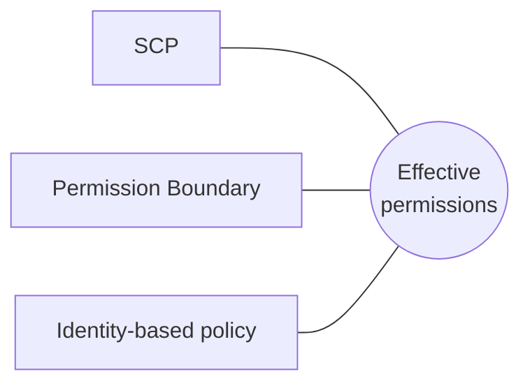

# Permission Boundaries

[⬅ Về mục lục section](README.md)

## 📖 Định nghĩa

| Thuật ngữ | Định nghĩa |
|---|---|
| **Permission boundary** | Managed policy gắn vào user/role để đặt *giới hạn trên* cho quyền mà identity-based policy có thể cấp; bản thân nó không cấp quyền. |
| **Effective permissions** | Quyền thực tế = giao của tất cả lớp giới hạn (SCP, RCP, boundary, session policy) với các policy cấp quyền. |
| **Privilege escalation** | Hành vi một principal tự nâng quyền của mình vượt mức được phép (vd tự gắn AdministratorAccess). |

## Nội dung chính

- Áp dụng cho **user và role** (**không** áp dụng cho group)
- Dùng **managed policy** để đặt **quyền tối đa** mà entity có thể có
- **Quyền thực tế = Identity policy ∩ Permission boundary** (∩ SCP nếu có)

Ví dụ: boundary cho phép `s3:*`, `cloudwatch:*`, `ec2:Describe*`; identity policy cho `iam:CreateUser` → **không có quyền gì** (giao nhau rỗng).

**Use case:**
- **Ủy quyền cho non-admin** (vd lead dev) tạo IAM user/role mới, nhưng **bắt buộc gắn boundary** cho entity mới (dùng condition `iam:PermissionsBoundary`)
- Cho developer tự gán policy cho mình mà **không leo thang quyền** (privilege escalation) thành admin
- Giới hạn **một user cụ thể** (SCP thì áp dụng cả account)
