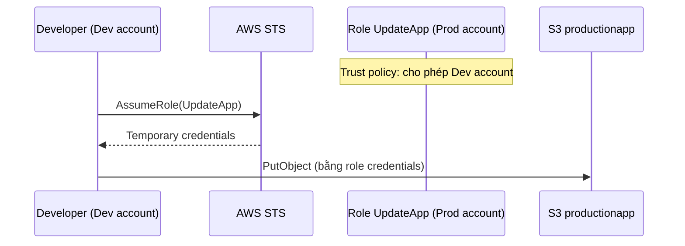

# AWS STS (Security Token Service)

[⬅ Về mục lục section](README.md)

## 📖 Định nghĩa

| Thuật ngữ | Định nghĩa |
|---|---|
| **AWS STS** | Dịch vụ phát hành **temporary security credentials** (access key, secret key, session token) có thời hạn cho user/role/federated user. |
| **Temporary credentials** | Bộ credential tự hết hạn sau 15 phút–36 giờ tùy API, không cần thu hồi thủ công. |
| **Trust policy** | Resource-based policy của role, khai báo principal nào được phép gọi `sts:AssumeRole*`. |
| **External ID** | Giá trị bí mật do bên thứ 3 cấp, bắt buộc truyền khi assume role để chống confused deputy. |
| **Session tags** | Tag truyền vào lúc tạo session, dùng cho ABAC. |
| **Role chaining** | Dùng credential của một role để assume tiếp role khác; thời hạn tối đa 1 giờ. |

## Nội dung chính

### AssumeRole

> 📖 **Định nghĩa:** **AssumeRole** là API của STS cho phép một principal tạm thời “đóng vai” một IAM role và nhận bộ credential tạm thời mang quyền của role đó. **Trust policy** là resource-based policy gắn vào role, quy định *ai được phép assume* role.

- Định nghĩa role, **trust policy** = ai được assume
- STS trả về **temporary credentials** (AccessKeyId, SecretAccessKey, SessionToken)
- Thời hạn **15 phút → 12 giờ** (mặc định 1h; role chaining tối đa 1h)
- **Thu hồi session đang hoạt động:** gắn inline policy `AWSRevokeOlderSessions` (Deny mọi thứ với `aws:TokenIssueTime` < thời điểm thu hồi)

### Khi nào dùng AssumeRole

> 📖 **Định nghĩa:** **Role session** là phiên làm việc được tạo ra mỗi lần assume role, có thời hạn và định danh riêng (session name).

- User account A truy cập account B (cả hai bạn sở hữu)
- Bên thứ 3 truy cập account bạn
- AWS service truy cập resource
- User xác thực bên ngoài (federation)

### Cross-account trong cùng tổ chức

> 📖 **Định nghĩa:** **Cross-account access** là việc principal ở account A truy cập resource ở account B; với role, account B tạo role tin account A, account A cấp quyền `sts:AssumeRole` cho user của mình.

Lợi ích: phải **cấp quyền rõ ràng** để assume, user phải **chủ động switch role**, có thể **yêu cầu MFA** khi assume (`aws:MultiFactorAuthPresent` trong trust policy), audit qua **CloudTrail**.



### Bên thứ 3 & **Confused Deputy**

> 📖 **Định nghĩa:** **Confused deputy** là lỗ hổng khi một bên trung gian có quyền cao (deputy) bị bên khác lợi dụng để thực hiện hành động thay họ. **External ID** là chuỗi định danh duy nhất mà bên thứ 3 cấp cho từng khách hàng, đưa vào trust policy để chống confused deputy.

- Cần: **Account ID** của bên thứ 3 + **External ID**
- **External ID**: chuỗi bí mật, **do bên thứ 3 tạo ra**, duy nhất cho mỗi khách hàng; khai báo trong trust policy (`sts:ExternalId`) và **phải truyền khi assume**
- **Confused deputy:** bên thứ 3 (deputy) phục vụ nhiều khách hàng. Nếu không có External ID, khách hàng X có thể đưa ARN role *của bạn* cho deputy → deputy vô tình truy cập account bạn thay X. External ID đảm bảo deputy chỉ assume role của bạn khi đang hành động cho bạn.

```json
{
  "Effect": "Allow",
  "Principal": { "AWS": "arn:aws:iam::111122223333:root" },
  "Action": "sts:AssumeRole",
  "Condition": { "StringEquals": { "sts:ExternalId": "unique-id-from-3rd-party" } }
}
```

> 💡 Với **AWS service** làm deputy (vd SNS, CloudTrail ghi vào S3), chống confused deputy bằng **`aws:SourceArn`** / **`aws:SourceAccount`** trong resource policy.

### Session Tags

> 📖 **Định nghĩa:** **Session tag** là cặp key-value truyền vào khi assume role hoặc federation, gắn vào role session và dùng được như `aws:PrincipalTag` trong policy.

- Truyền tag khi `AssumeRole` hoặc federation → trở thành `aws:PrincipalTag`
- Dùng cho **ABAC**: vd session tag `Department=HR` → chỉ truy cập bucket `hr-docs`
- Cần quyền `sts:TagSession` trong trust policy

### Các API quan trọng

> 📖 **Định nghĩa:** **STS API** là các lệnh của Security Token Service để phát hành credential tạm thời, mỗi API phục vụ một nguồn danh tính khác nhau.

| API | Dùng khi |
|---|---|
| `AssumeRole` | Role trong account hoặc cross-account |
| `AssumeRoleWithSAML` | User đăng nhập qua **SAML 2.0** IdP |
| `AssumeRoleWithWebIdentity` | User đăng nhập qua **OIDC** IdP (Google, Facebook, Amazon, **EKS IRSA**, **GitHub Actions OIDC**…). Với app mobile/web, AWS khuyên dùng **Cognito** |
| `GetSessionToken` | Lấy credential tạm **có MFA** cho IAM user hoặc root |
| `GetFederationToken` | Credential tạm cho **federated user** qua proxy/custom broker |
