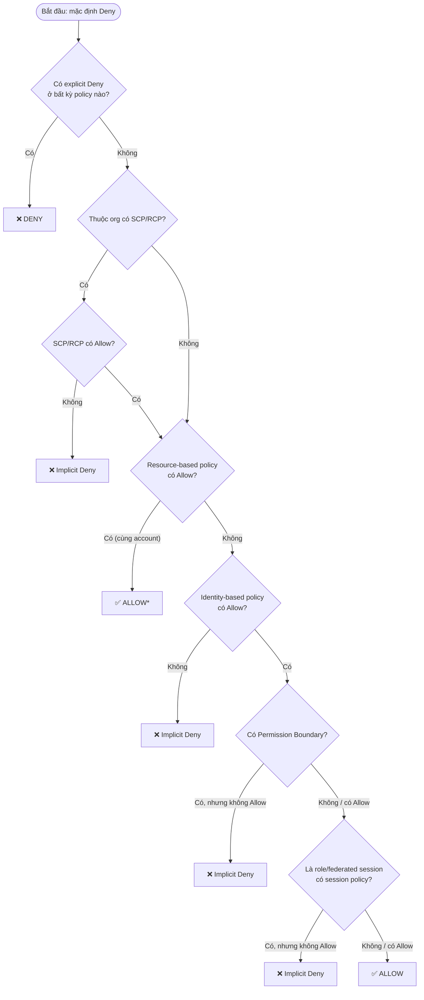

# SCP, các policy của Organizations & Policy Evaluation Logic

[⬅ Về mục lục section](README.md)

## 📖 Định nghĩa

| Thuật ngữ | Định nghĩa |
|---|---|
| **Service Control Policy (SCP)** | Loại policy của Organizations đặt *giới hạn quyền tối đa* cho mọi principal (kể cả root) trong account/OU; không tự cấp quyền. |
| **Resource Control Policy (RCP)** | Loại policy của Organizations đặt giới hạn quyền tối đa *trên resource* trong org, áp dụng cho mọi principal gọi tới. |
| **Tag Policy** | Policy chuẩn hóa tag key/giá trị được phép trên resource toàn org. |
| **Backup Policy** | Policy định nghĩa AWS Backup plan áp dụng tập trung cho các account. |
| **AI services opt-out policy** | Policy ngăn AWS AI services lưu/dùng nội dung của bạn để cải thiện dịch vụ. |
| **Declarative policy** | Policy ép cấu hình baseline của service (vd chặn public AMI) ở cấp org. |
| **Service-linked role** | Role được định nghĩa sẵn, gắn với một AWS service cụ thể, service dùng để thao tác thay bạn; không bị SCP giới hạn. |

## Service Control Policies (SCP)

- Định nghĩa **allowlist hoặc blocklist** các IAM action
- Gắn ở **Root, OU hoặc Account**
- **KHÔNG áp dụng cho management account**
- Áp dụng cho **mọi user & role trong account, kể cả root user**
- **KHÔNG ảnh hưởng service-linked role**
- **SCP không cấp quyền** – chỉ đặt giới hạn tối đa; vẫn cần IAM policy Allow
- Phải có **Allow tường minh ở mọi cấp** từ Root → từng OU → account (mặc định gắn `FullAWSAccess`)
- Use case: cấm service (vd không dùng EMR), tuân thủ PCI, khóa region, bắt buộc tag, chặn tắt CloudTrail/GuardDuty, chặn rời org

### Kế thừa SCP – ví dụ

> 📖 **Định nghĩa:** **SCP inheritance** là việc SCP gắn ở cấp cha (Root/OU) áp dụng xuống mọi OU và account con; quyền hiệu lực là **giao** của tất cả SCP trên đường đi.

- Root: `FullAWSAccess` + Deny Athena → **toàn org** không dùng Athena (trừ management account)
- OU Sandbox: `FullAWSAccess` + Deny S3 → mọi account trong Sandbox (và OU con) không dùng S3
- OU Test (con của Sandbox) chỉ gắn `Allow EC2` → account trong đó **chỉ dùng EC2** (vì allowlist)
- Account A gắn thêm Deny EC2 → A không dùng S3 (từ Sandbox), không dùng EC2

### Blocklist vs Allowlist

> 📖 **Định nghĩa:** **Blocklist (deny list)** là chiến lược cho phép tất cả rồi chặn từng thứ; **Allowlist** là chiến lược chặn tất cả rồi chỉ cho phép từng thứ.

- **Blocklist** (phổ biến): giữ `FullAWSAccess`, thêm statement `Deny` cho cái cần cấm
- **Allowlist**: gỡ `FullAWSAccess`, chỉ `Allow` những service cho phép

### Ví dụ: chặn region (trừ global services)

> 📖 **Định nghĩa:** **`aws:RequestedRegion`** là condition key chứa region mà API call nhắm tới. **Global service** (IAM, Organizations, Route 53, CloudFront…) có endpoint ở `us-east-1` nên phải loại trừ khi chặn region.

```json
{
  "Effect": "Deny",
  "NotAction": ["iam:*", "organizations:*", "route53:*", "cloudfront:*", "support:*", "sts:*"],
  "Resource": "*",
  "Condition": {
    "StringNotEquals": { "aws:RequestedRegion": ["ap-southeast-1", "us-east-1"] },
    "ArnNotLike": { "aws:PrincipalARN": "arn:aws:iam::*:role/OrgAdminRole" }
  }
}
```

### Ví dụ: bắt buộc tag khi tạo EC2

> 📖 **Định nghĩa:** **`aws:RequestTag/<key>`** là condition key chứa giá trị tag được truyền trong request tạo resource; dùng với operator `Null` để kiểm tra tag có tồn tại không.

```json
{
  "Effect": "Deny",
  "Action": "ec2:RunInstances",
  "Resource": ["arn:aws:ec2:*:*:instance/*", "arn:aws:ec2:*:*:volume/*"],
  "Condition": { "Null": { "aws:RequestTag/CostCenter": "true" } }
}
```

### IAM Policy Evaluation Logic (thứ tự đánh giá)

> 📖 **Định nghĩa:** **Policy evaluation logic** là thuật toán AWS dùng để quyết định một request bị Allow hay Deny, sau khi xét tất cả loại policy liên quan. **Session policy** là policy truyền vào lúc assume role/federation để thu hẹp thêm quyền của session.



\* Trong **cùng account**, resource-based policy cấp quyền cho principal là đủ (trừ khi bị permission boundary/session policy giới hạn với role session). **Cross-account**: cần Allow ở **cả** identity policy (bên gọi) **và** resource policy (bên nhận).

### 🆕 Bổ sung ngoài slide (cập nhật AWS)

> 📖 **Định nghĩa:** **Data perimeter** là tập các guardrail đảm bảo *chỉ danh tính tin cậy* truy cập *tài nguyên tin cậy* từ *mạng mong đợi*.

- **Resource Control Policies (RCP)** (11/2024): giới hạn quyền tối đa **trên resource** trong org (S3, STS, KMS, SQS, Secrets Manager…), áp dụng **bất kể principal là ai** – kể cả principal ngoài org. Dùng để xây **data perimeter** (vd: chỉ principal trong org mới truy cập S3). SCP = giới hạn *principal*, RCP = giới hạn *resource*.
- **Declarative policies** (12/2024): ép cấu hình baseline cho service (vd chặn public AMI, bắt buộc IMDSv2, chặn VPC public access) — được duy trì kể cả khi service ra API mới.
- **Centralized root access management** (11/2024): quản lý/xóa root credential của member account tập trung, thực hiện tác vụ root có thời hạn từ management/delegated admin account.
- **Data perimeter** keys hay gặp: `aws:PrincipalOrgID`, `aws:ResourceOrgID`, `aws:SourceVpce`, `aws:SourceOrgID`.

## Các loại policy khác của Organizations

| Policy | Mục đích |
|---|---|
| **Tag Policies** | Chuẩn hóa tag key & giá trị cho phép; báo cáo resource không tuân thủ; có thể **ngăn thao tác tag không tuân thủ**; theo dõi qua **EventBridge**; hỗ trợ Cost Allocation Tags & ABAC |
| **AI Services Opt-out** | Không cho AWS AI services (Lex, Comprehend, Polly, Rekognition…) lưu/dùng nội dung để cải thiện dịch vụ; chọn tất cả hoặc từng service; áp dụng Root/OU/account |
| **Backup Policies** | Định nghĩa Backup Plan (tần suất, cửa sổ, region copy…) cho toàn org; member account **chỉ xem**, không sửa |
| SCP / RCP / Declarative | Xem mục 10 |

> 💡 Tag Policy **không bắt buộc phải có tag** — chỉ ép *định dạng/giá trị* khi tag được gắn. Muốn **bắt buộc có tag** khi tạo resource → **SCP** với `Null` condition.
