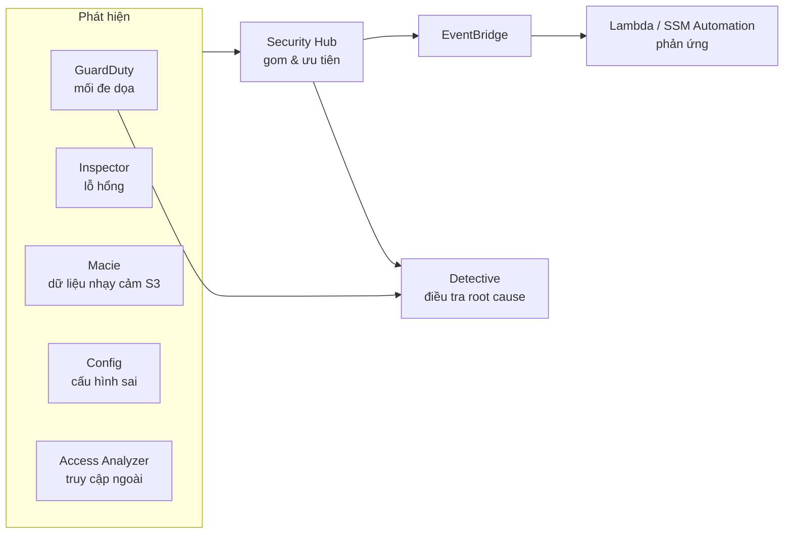

# AWS Security Hub & Amazon Detective

[⬅ Về mục lục section](README.md)

## 📖 Định nghĩa

| Thuật ngữ | Định nghĩa |
|---|---|
| **AWS Security Hub** | Công cụ bảo mật **trung tâm**: gom finding từ nhiều dịch vụ AWS và đối tác, chạy kiểm tra tuân thủ tự động, hiển thị trên dashboard thống nhất cho nhiều account. |
| **ASFF** | *AWS Security Finding Format* – định dạng JSON chuẩn cho finding trong Security Hub. |
| **Security standard** | Bộ kiểm tra tuân thủ dựng sẵn (AWS Foundational Security Best Practices, CIS AWS Foundations, PCI DSS, NIST 800-53). |
| **Amazon Detective** | Dịch vụ **điều tra** sự cố bảo mật: dùng ML và **graph** để phân tích, tìm **nguyên nhân gốc (root cause)**. |

## Nội dung chính

### AWS Security Hub

> 📖 **Định nghĩa:** **Aggregation** là việc gom finding từ nhiều account và region về một account/region quản trị.

- Quản lý bảo mật **nhiều account**, **tự động hóa kiểm tra**
- **Dashboard tích hợp** trạng thái bảo mật & tuân thủ
- Gom finding từ: **Config, GuardDuty, Inspector, Macie, IAM Access Analyzer, Systems Manager, Firewall Manager, AWS Health**, giải pháp đối tác APN
- **Phải bật AWS Config trước** (để chạy security standard)
- Phát **EventBridge event** cho finding → tự động phản ứng (Lambda, SSM Automation, ticket)
- **Automation rules**: tự cập nhật/ẩn/đổi mức độ finding theo tiêu chí
- Tích hợp Organizations: **delegated admin**, cross-region aggregation
- 🆕 2025: Security Hub mới **tương quan** tín hiệu từ GuardDuty, Inspector, Macie… thành **exposure findings**, ưu tiên rủi ro; tính năng kiểm tra tuân thủ cũ đổi tên thành **Security Hub CSPM**

### Amazon Detective

> 📖 **Định nghĩa:** **Behavior graph** là mô hình đồ thị liên kết các thực thể (IP, user, role, instance) và hoạt động của chúng theo thời gian.

- GuardDuty, Macie, Security Hub **phát hiện** vấn đề; **Detective điều tra sâu** để tìm nguyên nhân gốc
- Tự thu thập & xử lý event từ **VPC Flow Logs, CloudTrail, GuardDuty** (và EKS audit log, Security Hub finding) → **góc nhìn thống nhất**
- Tạo **trực quan hóa** với ngữ cảnh chi tiết để tìm root cause

### Bức tranh các dịch vụ bảo mật

> 📖 **Định nghĩa:** **Detect → Investigate → Respond** là chu trình phát hiện, điều tra và phản ứng với sự cố bảo mật.

> 📖 **Amazon Macie** (nhắc thêm): dịch vụ dùng ML để **phát hiện dữ liệu nhạy cảm (PII)** trong S3.

## 🎯 Mẹo thi

- "Một nơi xem tất cả finding bảo mật của 50 account" → **Security Hub** (delegated admin + aggregation)
- "Kiểm tra tuân thủ CIS/PCI tự động" → **Security Hub standards** (cần Config)
- "Tìm nguyên nhân gốc của finding GuardDuty" → **Detective**
- "Tìm PII trong S3" → **Macie**
