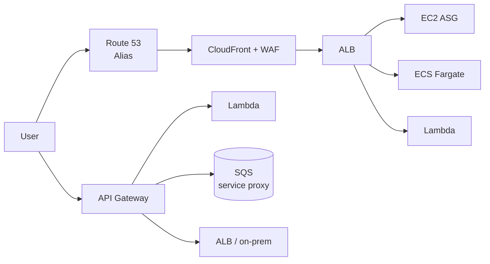

# So sánh kiến trúc Compute + Load Balancing

[⬅ Về mục lục section](README.md)

## 📖 Định nghĩa

| Thuật ngữ | Định nghĩa |
|---|---|
| **Stateless application** | Ứng dụng không lưu trạng thái phiên trên server → instance nào cũng phục vụ được mọi request, dễ scale ngang. |
| **Horizontal scaling** | Tăng năng lực bằng cách **thêm máy** (scale out); khác **vertical scaling** là tăng cấu hình một máy (scale up). |
| **DNS-based load balancing** | Chia tải bằng cách trả nhiều IP trong DNS; phụ thuộc TTL và cache của client. |
| **Pre-warming** | Yêu cầu AWS chuẩn bị trước dung lượng LB cho đợt tải đột biến lớn (🆕 nay có **LB Capacity Unit Reservation**). |
| **Cold start** | Độ trễ khởi tạo khi serverless function chạy lần đầu/sau thời gian rảnh. |

## Nội dung chính

### Các mẫu kiến trúc

> 📖 **Định nghĩa:** **Architecture pattern** là cách ghép dịch vụ đã được kiểm chứng cho một loại bài toán.

| Kiến trúc | Ưu điểm | Nhược điểm / lưu ý |
|---|---|---|
| **EC2 + Elastic IP** | Failover nhanh bằng cách **chuyển EIP** sang standby; client không thấy thay đổi; IP public tĩnh; rẻ | **Không scale** |
| **EC2 + Route 53 (nhiều A record, không EIP)** | "DNS-based load balancing", nhiều instance | Client có thể nhận **thông tin cũ do TTL**; client phải xử lý lỗi phân giải; instance mới **không nhận đủ traffic ngay** |
| **ALB + ASG** | Kiến trúc kinh điển, scale tốt; instance mới **phục vụ ngay**; không gửi tới instance lỗi; Multi-AZ, cross-zone | **Scale chậm** (khởi động + bootstrap EC2 → dùng AMI); ALB **không chịu được đỉnh đột ngột cực lớn** (pre-warm); có thể mất vài request khi quá tải; target utilization nên **40–70%** |
| **ALB + ECS on EC2 (ASG)** | Như ALB + ASG, chạy Docker, **dynamic port mapping** | **Khó phối hợp** ECS service auto scaling + ASG auto scaling (dùng capacity provider) |
| **ALB + ECS on Fargate** | Service auto scaling dễ; **in-service nhanh** (không chờ EC2); tầng app "serverless" | Vẫn **giới hạn bởi ALB** khi đỉnh đột ngột |
| **ALB + Lambda** | Scale liền mạch; expose Lambda qua HTTP/S **không cần tính năng API Gateway**; kết hợp **WAF**; tốt cho **microservices lai** (ECS cho một số route, Lambda cho route khác) | Giới hạn runtime Lambda |
| **API Gateway + Lambda** | Trả theo request, scale liền mạch, **fully serverless**; có auth, rate limit, cache; tích hợp X-Ray | Soft limit: **10.000 rps API Gateway**, **1.000 concurrent Lambda**; **cold start** |
| **API Gateway + AWS Service (proxy)** | **Độ trễ thấp hơn, rẻ hơn**; không tốn concurrency Lambda, không code; expose an toàn SQS, SNS, Step Functions… | Giới hạn **payload 10 MB** (vấn đề với proxy S3) |
| **API Gateway + HTTP backend (ALB, on-prem, bên thứ 3)** | Thêm auth, rate control, API key, cache trên backend tùy biến | Thêm độ trễ một hop |

### Sơ đồ tham chiếu

> 📖 **Định nghĩa:** **Edge → Web → Compute** là luồng request đi từ client qua DNS/CDN, lớp nhận request rồi tới lớp xử lý.

## 🎯 Mẹo thi

- "Ít vận hành nhất, trả theo request" → **API Gateway + Lambda**
- "Ghi vào SQS từ REST không cần code" → **API Gateway service integration**
- "Container, không quản lý EC2, scale nhanh" → **ALB + ECS Fargate**
- "Đỉnh tải cực lớn đột ngột (flash sale)" → pre-warm/LCU reservation, **queue (SQS)** để hấp thụ, cache CloudFront
- "Failover đơn giản 1 instance, IP không đổi" → **Elastic IP chuyển sang standby**
