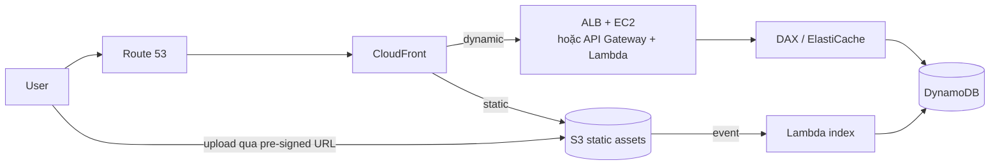

# Kiến trúc lưu trữ & So sánh chi phí

[⬅ Về mục lục section](README.md)

## 📖 Định nghĩa

| Thuật ngữ | Định nghĩa |
|---|---|
| **Static content** | Nội dung không đổi theo từng request (ảnh, CSS, JS, video) – phù hợp cache và S3. |
| **Dynamic content** | Nội dung sinh ra theo từng request (API, trang cá nhân hóa) – cần compute (ALB + EC2, API Gateway + Lambda). |
| **Metadata index** | Bảng lưu thông tin mô tả object (tên, ngày, kích thước, chủ sở hữu) để **tìm kiếm/truy vấn** thứ mà S3 không làm được. |
| **GB-month** | Đơn vị tính phí lưu trữ: 1 GB lưu trong 1 tháng. |

## Nội dung chính

### Expose static objects

> 📖 **Định nghĩa:** **Origin** là nơi CloudFront lấy nội dung gốc.

| Kiến trúc | Ghi chú |
|---|---|
| CloudFront → **EC2 + EBS** | Đơn giản, không scale tốt |
| CloudFront → **ALB → ASG + EFS** | Nhiều instance đọc chung file |
| CloudFront → ALB → ASG + **Instance Store** | Hiệu năng cao nhưng dữ liệu tạm thời, phải tự đồng bộ |
| CloudFront → **S3** | **Tốt nhất** cho nội dung tĩnh: rẻ, bền, không quản lý server (dùng **OAC**) |

### Đánh index object S3 bằng DynamoDB

> 📖 **Định nghĩa:** Xem *Metadata index* ở bảng trên.

- Ghi object vào S3 → **event** → **Lambda** → ghi metadata vào **DynamoDB**
- Xây **API truy vấn metadata**: tìm theo ngày, tổng dung lượng của một khách hàng, liệt kê object theo thuộc tính, object upload trong khoảng thời gian
- 🆕 Thay thế managed: **S3 Metadata** (tự sinh bảng metadata dạng **Apache Iceberg** trong **S3 Tables**, query bằng Athena)

### Kiến trúc tổng thể static + dynamic

> 📖 **Định nghĩa:** **Layered architecture** là chia ứng dụng thành các lớp tách biệt (DNS, CDN, dynamic, cache, DB, static).

### Giá lưu trữ (USD/GB-tháng, tham khảo us-east-1)

> 📖 **Định nghĩa:** Xem *GB-month* ở bảng trên. Giá chỉ để **so sánh tương đối**, thay đổi theo thời gian và region.

| S3 | Giá | EBS | Giá | EFS | Giá |
|---|---|---|---|---|---|
| Standard | $0.023 | io1/io2 | $0.125 + $0.065/IOPS | Standard | $0.30 |
| Standard-IA | $0.0125 | gp2 | $0.10 | One Zone | $0.16 |
| One Zone-IA | $0.01 | gp3 | $0.08 | Standard-IA | $0.025 |
| Intelligent-Tiering | $0.023 | st1 | $0.045 | One Zone-IA | $0.0133 |
| Glacier Instant | $0.004 | sc1 | $0.015 | | |
| Glacier Flexible | $0.0036 | | | | |
| Glacier Deep Archive | **$0.00099** | | | | |

**Thứ tự đắt → rẻ (gần đúng):** EFS Standard/One Zone → EBS io1/io2 → EBS gp2/gp3 → EBS st1 → S3 Standard → EFS IA → EBS sc1 → S3 Standard-IA… → Glacier Deep Archive

## 🎯 Mẹo thi

- "Phục vụ ảnh tĩnh toàn cầu rẻ nhất" → **CloudFront + S3 (OAC)**
- "Tìm object S3 theo ngày/thuộc tính" → **index metadata trong DynamoDB** (S3 event + Lambda) hoặc S3 Metadata 🆕
- "Upload trực tiếp từ client không qua server" → **pre-signed URL**
- "Rẻ nhất cho lưu trữ lâu dài" → **Glacier Deep Archive**
